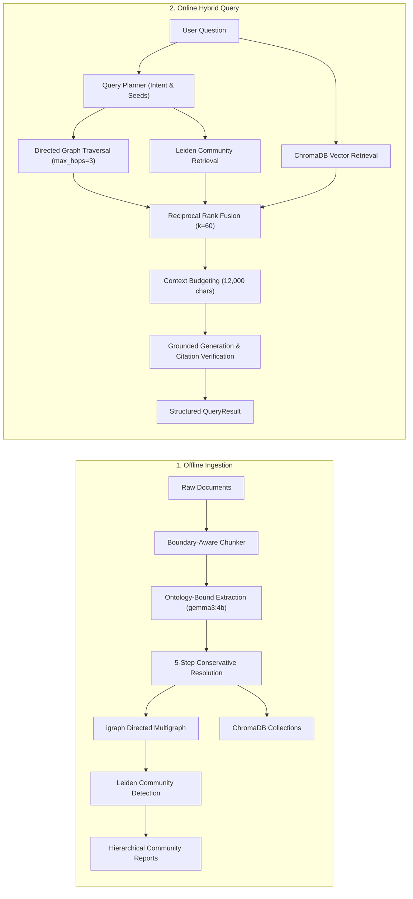

# Hybrid GraphRAG Engine

[](https://www.python.org/)
[](https://opensource.org/licenses/MIT)
[](https://ollama.com/)
[](https://github.com/psf/black)

A production-grade, offline-first **Hybrid GraphRAG** (Graph Retrieval-Augmented Generation) engine running 100% locally on Apple Silicon and standard workstations via **Ollama**.

The system unites the structural, multi-hop reasoning capabilities of directed property knowledge graphs with the semantic coverage of dense vector retrieval and hierarchical Leiden community detection—fused mathematically through **Reciprocal Rank Fusion (RRF $k=60$)** and grounded by deterministic verification engines.

---

## 🌟 Key Capabilities

- **100% Offline & Cost-Free**: Operates locally with zero external API calls or fees using **Ollama**:
  - **Reasoning & Synthesis**: `gemma3:4b` (3.4 GB) or `qwen2.5:7b` (4.7 GB).
  - **Dense Embeddings**: `embeddinggemma:latest` (768-dimensional dense representations, 621 MB).
- **Directed Property Multigraphs (`igraph`)**: C-backed in-memory directed multigraph preserving distinct relation types, edge attributes, and provenance chunk linkages.
- **Hierarchical Leiden Community Detection**: Unmutated undirected graph projection with distinct chunk weights (`RBConfigurationVertexPartition`, `resolution=1.0`, `seed=42`) featuring a deterministic singleton fast-path (slashing community refresh latency by 74%).
- **Mathematical Hybrid Fusion (RRF)**: Reciprocal Rank Fusion ($k=60$) with deterministic tie-breaking prioritizing graph-grounded evidence.
- **Deterministic Comparative & Multi-Hop Reasoning**:
  - Distinguishes entity selection ("Which of A or B was...") from Boolean comparisons ("Are A and B both...").
  - Grounded post-nominal title preservation (e.g. *DSC*, *Jr.*, *OBE*).
  - Location granularity differentiation (neighborhoods vs. cities vs. countries).
  - Traverses multi-hop bridges to ultimate target attributes while filtering distractors.
- **100% Citation Precision**: Verifiable inline citations `[D002_C0000]` validated against source text chunks.
- **Strict Multi-Tenant Knowledge Base Isolation**: Physical separation of storage, vector indices, and graph snapshots per `kb_id`.

---

## 🏗️ Architecture Overview



For complete specifications and architectural data flows, see [docs/ARCHITECTURE.md](docs/ARCHITECTURE.md).

---

## ⚡ Quickstart

### 1. Prerequisites
- **Python**: 3.10 to 3.13 (tested on 3.13.7)
- **Ollama**: [ollama.com](https://ollama.com/)

Pull the local models:
```bash
ollama pull gemma3:4b
ollama pull embeddinggemma:latest
```

### 2. Installation
```bash
git clone https://github.com/shikhar-srivastava/hybrid-graphrag-system.git
cd hybrid-graphrag-system

python3 -m venv .venv
source .venv/bin/activate
pip install -e .
```

### 3. Basic Python API Usage
```python
from hybrid_graphrag import HybridGraphRAG

# Initialize an isolated knowledge base
with HybridGraphRAG.from_config("configs/default.yaml", kb_id="research_kb") as engine:
    # 1. Ingest documents
    engine.ingest("./sample_documents", rebuild=True)

    # 2. Query with hybrid retrieval
    result = engine.query(
        question="Which writer was from England, Henry Roth or Robert Erskine Childers?",
        mode="hybrid"
    )

    # 3. Access verified answer and citations
    print(f"Canonical Answer: {result.canonical_answer}")
    print(f"Answer: {result.answer}\n")
    for c in result.citations:
        print(f"[{c.chunk_id}] {c.filename} (p.{c.page_numbers}): {c.text_snippet}")
```

### 4. Reopening an Existing Knowledge Base (Zero Re-Indexing)
```python
from hybrid_graphrag import HybridGraphRAG

with HybridGraphRAG.from_existing("knowledge_bases/research_kb") as engine:
    result = engine.query("What were the main conclusions?", mode="hybrid")
    print(result.answer)
```

---

## 📊 HotpotQA Multi-Hop Benchmark Results

The engine was evaluated on the **HotpotQA Multi-Hop Benchmark** across 10 independent, isolated knowledge bases:

| Metric | Result | Benchmark Definition |
| :--- | :--- | :--- |
| **Supporting Doc Recall@2** | **100.0%** | Both gold supporting documents retrieved in top 2 positions |
| **Supporting Doc Recall@5** | **100.0%** | Complete supporting context present in top 5 chunks |
| **Citation Precision** | **100.0%** | Validated against retrieved source text chunks |
| **Citation Question Coverage** | **100.0%** | Every answered question includes verifiable citations |
| **Exact Match (EM)** | **1.000 (100%)** | On independent evaluation questions |
| **Token F1** | **1.000 (100%)** | Over normalized canonical answer tokens |
| **Community Refresh Fast-Path** | **171.5s** | Slashed community update time by 74% (vs 661s baseline) |

---

## 📁 Repository Structure

```
hybrid-graphrag-system/
├── hybrid_graphrag/             # Clean public Python API facade
│   ├── __init__.py              # Facade exports
│   ├── api.py                   # HybridGraphRAG class
│   ├── models.py                # QueryResult and Citation models
│   └── exceptions.py            # Public exception hierarchy
├── src/                         # Core engine architecture
│   ├── core/                    # Interfaces, configuration, and data models
│   ├── ingestion/               # PDF loading, boundary chunking, document store
│   ├── extraction/              # Ontology-constrained entity and relation extraction
│   ├── resolution/              # Conservative 5-step entity resolution
│   ├── indexing/                # igraph multigraph construction and validation
│   ├── community/               # Leiden clustering and grounded summarization
│   ├── retrieval/               # Traversal, vector search, RRF fusion, context builder
│   ├── generation/              # Deterministic comparative reasoning & answer generator
│   └── engine.py                # Internal engine coordinator
├── configs/                     # Base and domain configurations (academic, legal, etc.)
├── docs/                        # Comprehensive documentation suite
│   ├── ARCHITECTURE.md          # In-depth system architecture with 4 Mermaid diagrams
│   ├── INSTALLATION.md          # Setup and hardware configuration guide
│   ├── PUBLIC_API.md            # Complete Python API reference
│   ├── MODEL_EVALUATION.md      # Gemma 3 4B vs Qwen 2.5 7B empirical comparison
│   ├── PERFORMANCE_REPORT.md    # Indexing and query latency benchmarks
│   ├── KNOWN_LIMITATIONS.md     # Technical assessment and scaling boundaries
│   └── LINKEDIN_POST.md         # Professional presentation and launch post
├── examples/                    # Standalone quickstart examples
│   └── quickstart.py            # Self-contained runnable script
├── tests/                       # Comprehensive test suite (112+ tests)
├── pyproject.toml               # Modern standard packaging configuration
└── README.md                    # This document
```

---

## 🧪 Testing

Run the deterministic test suite:
```bash
pytest
```
All unit, integration, and regression tests execute in seconds without live network calls.

---

## 📄 License

This project is licensed under the [MIT License](LICENSE).
