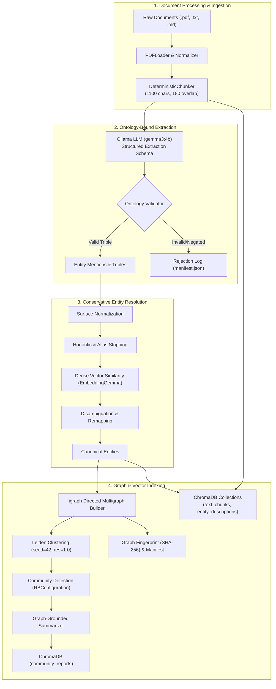
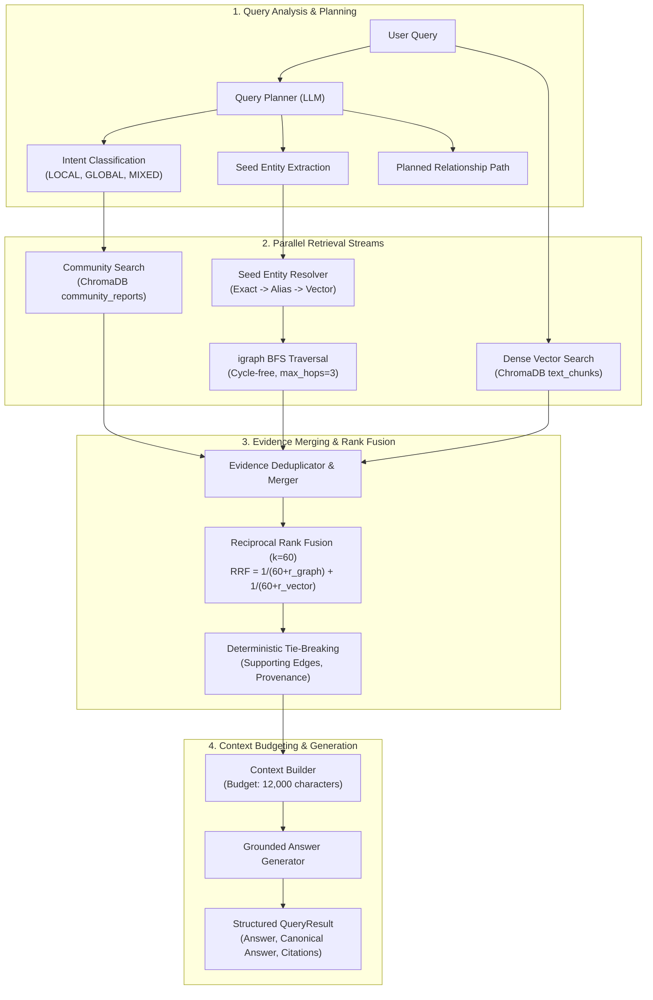
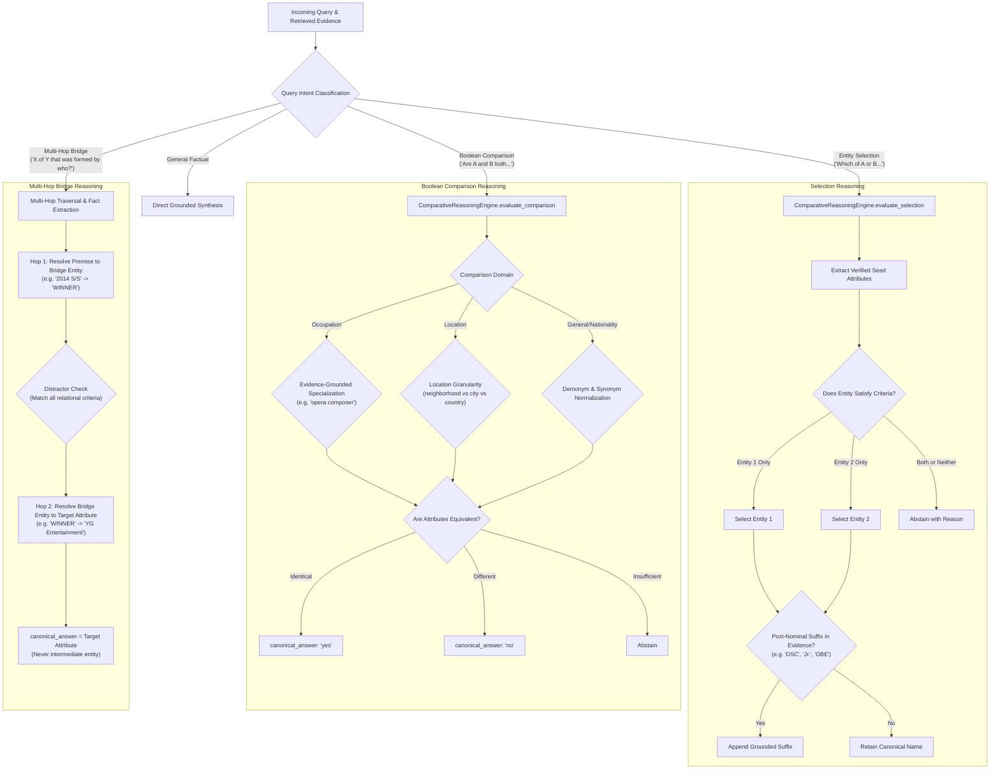
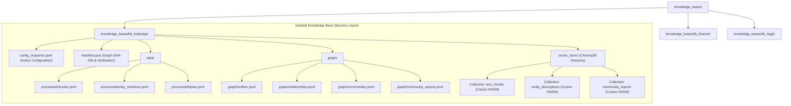

# Enterprise Hybrid GraphRAG Engine: System Architecture

## 1. Executive Summary & Design Principles

The **Hybrid GraphRAG Engine** is an enterprise-grade, offline-first Retrieval-Augmented Generation system. It synthesizes the deterministic topological precision of directed property knowledge graphs with the semantic versatility of dense vector retrieval and hierarchical community clustering.

### Core Architectural Axioms
1. **Zero External API Dependencies**: Built 100% on local model infrastructure using **Ollama** (`gemma3:4b` / `qwen2.5:7b` for reasoning and extraction; `embeddinggemma:latest` for 768-dimensional dense representations).
2. **Deterministic Topological Grounding**: Facts, relations, and communities maintain immutable bi-directional provenance linkages back to original document text chunks and character spans.
3. **Multi-Domain Tenant Isolation**: Physical separation of storage, vector indices, graph partitions, and configuration snapshots per Knowledge Base ID (`kb_id`), preventing cross-domain information leakage.
4. **Deterministic Reasoning Engine**: Comparative queries (Boolean equivalence and entity selection) and multi-hop bridge questions are resolved through rule-grounded, verifiable verification layers rather than speculative generative hallucinations.

---

## 2. Ingestion Pipeline Architecture

The ingestion pipeline converts unstructured heterogeneous documents (PDFs, Markdown, text) into validated multigraph representations, vector indices, and hierarchical Leiden community summaries.

### Ingestion Stages
1. **Document Loading & Normalization**: Deterministic alphabetical file ordering, sequential identifier assignment (`D001`, `D002`), line-ending canonicalization (`\r\n` $\to$ `\n`), per-page tracking.
2. **Deterministic Chunking**: Sliding-window chunker with character limit ($1,100$) and overlap ($180$). Boundary preference heuristics prioritize paragraphs, sentences, and punctuation within the final 25% boundary window.
3. **Ontology-Bound Extraction**: Extraction prompt restricted by strict domain ontology (`DomainOntology`). Rejects quote mismatches, negated facts, and invalid endpoint entity types.
4. **Conservative Entity Resolution**: 5-step resolution pipeline: surface matching $\to$ honorific stripping $\to$ exact/alias matching $\to$ embedding cosine similarity ($\ge 0.82$) $\to$ ambiguous band verification.
5. **Directed Multigraph Construction**: Preserves distinct relationship types on directed multigraph edges in `igraph`, aggregating duplicate edges and merging provenance chunk sets.
6. **Leiden Community Detection**: Projects unmutated undirected graph with distinct chunk support weights, computing Leiden partitions with fixed random seed ($42$).
7. **Graph-Grounded Community Summarization**: Hierarchical community report generation featuring deterministic fast-path for singletons and grounded LLM synthesis for multi-node clusters.

---

## 3. Retrieval & Fusion Pipeline

The retrieval pipeline dynamically adapts to query complexity, retrieving structural paths, semantic chunks, and high-level community overviews, combining them via Reciprocal Rank Fusion (RRF).

### Retrieval Stages
1. **Query Planning**: LLM classifies question intent into `LOCAL` (entity-centric), `GLOBAL` (thematic overview), or `MIXED` (multi-hop relational). Identifies seed entities and predicted traversal paths.
2. **Seed Entity Resolution**: Matches seed entity specifications against canonical graph nodes using exact string, normalized alias, and embedding fallback.
3. **Directed Graph Traversal**: Breadth-First Search (BFS) up to `max_hops=3`, enforcing cycle prevention, optional tenant/scope filtering, and scoring edge type relevance.
4. **Dense Vector Retrieval**: HNSW cosine similarity lookup over text chunk embeddings.
5. **Hierarchical Community Retrieval**: Semantic discovery across macro-thematic community reports for global context.
6. **Reciprocal Rank Fusion (RRF)**: Merges candidates across retrieval channels with formula:
   $$\text{RRF}(d) = \sum_{m \in \{\text{graph}, \text{vector}\}} \frac{1}{k + r_m(d)} \quad (k=60)$$
   Ties are broken deterministically by graph supporting edge count, graph presence, and chunk ID.
7. **Context Construction**: Formats Community Overviews, Directed Graph Paths, and Text Chunks within a strict $12,000$ character window budget.

---

## 4. Deterministic Comparative & Multi-Hop Reasoning

To eliminate LLM hallucinations on comparative and multi-hop queries, the engine implements a deterministic verification layer.

---

## 5. Storage Layer & Multi-Tenant Knowledge Base Isolation

All data artifacts are physically isolated within dedicated Knowledge Base directories:

### Isolation Guarantees
- **Config Immobility**: Once initialized or indexed, the configuration snapshot (`config_snapshot.yaml`) locks the chunking parameters, ontology, and embedding model.
- **Data Encapsulation**: ChromaDB collections and igraph indices exist strictly inside the `kb_id` subdirectory; queries to `kb_finance` cannot access vectors or vertices from `kb_legal`.
- **Integrity Verification**: `manifest.json` preserves the SHA-256 fingerprint of the serialized multigraph, ensuring corruption or accidental file modification is detected on load.
