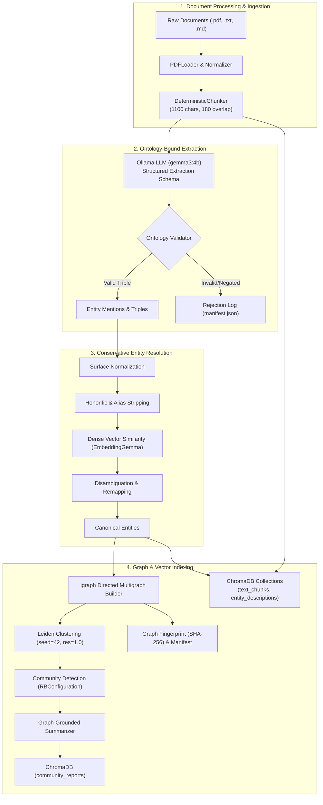
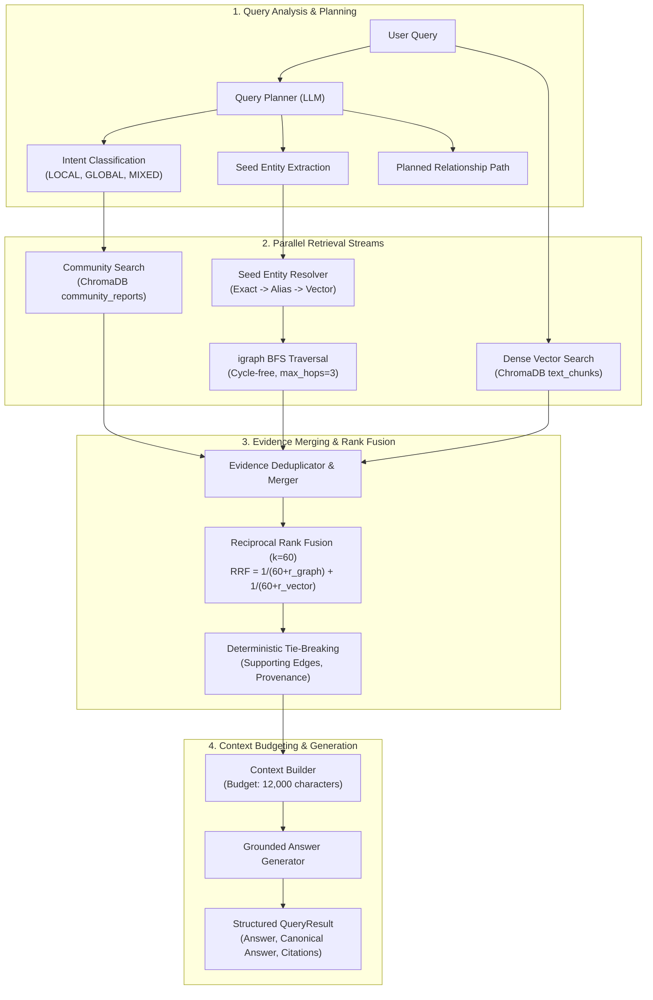
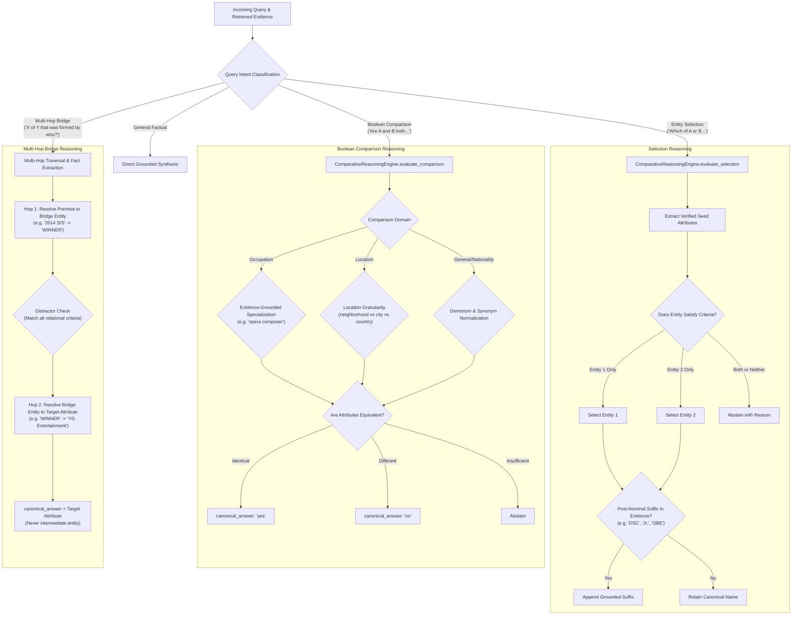
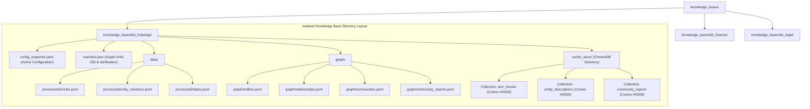

# Enterprise Hybrid GraphRAG Engine: System Architecture

## 1. Executive Summary & Design Principles

The **Hybrid GraphRAG Engine** is an enterprise-grade, offline-first Retrieval-Augmented Generation system. It synthesizes the deterministic topological precision of directed property knowledge graphs with the semantic versatility of dense vector retrieval and hierarchical community clustering.

### Core Architectural Axioms
1. **Zero External API Dependencies**: Built 100% on local model infrastructure using **Ollama** (`gemma3:4b` / `qwen2.5:7b` for reasoning and extraction; `embeddinggemma:latest` for 768-dimensional dense representations).
2. **Deterministic Topological Grounding**: Facts, relations, and communities maintain immutable bi-directional provenance linkages back to original document text chunks and character spans.
3. **Multi-Domain Tenant Isolation**: Physical separation of storage, vector indices, graph partitions, and configuration snapshots per Knowledge Base ID (`kb_id`), preventing cross-domain information leakage.
4. **Deterministic Reasoning Engine**: Comparative queries (Boolean equivalence and entity selection) and multi-hop bridge questions are resolved through rule-grounded, verifiable verification layers rather than speculative generative hallucinations.

---

## 2. Ingestion Pipeline Architecture

The ingestion pipeline converts unstructured heterogeneous documents (PDFs, Markdown, text) into validated multigraph representations, vector indices, and hierarchical Leiden community summaries.

### Ingestion Stages
1. **Document Loading & Normalization**: Deterministic alphabetical file ordering, sequential identifier assignment (`D001`, `D002`), line-ending canonicalization (`\r\n` $\to$ `\n`), per-page tracking.
2. **Deterministic Chunking**: Sliding-window chunker with character limit ($1,100$) and overlap ($180$). Boundary preference heuristics prioritize paragraphs, sentences, and punctuation within the final 25% boundary window.
3. **Ontology-Bound Extraction**: Extraction prompt restricted by strict domain ontology (`DomainOntology`). Rejects quote mismatches, negated facts, and invalid endpoint entity types.
4. **Conservative Entity Resolution**: 5-step resolution pipeline: surface matching $\to$ honorific stripping $\to$ exact/alias matching $\to$ embedding cosine similarity ($\ge 0.82$) $\to$ ambiguous band verification.
5. **Directed Multigraph Construction**: Preserves distinct relationship types on directed multigraph edges in `igraph`, aggregating duplicate edges and merging provenance chunk sets.
6. **Leiden Community Detection**: Projects unmutated undirected graph with distinct chunk support weights, computing Leiden partitions with fixed random seed ($42$).
7. **Graph-Grounded Community Summarization**: Hierarchical community report generation featuring deterministic fast-path for singletons and grounded LLM synthesis for multi-node clusters.

---

## 3. Retrieval & Fusion Pipeline

The retrieval pipeline dynamically adapts to query complexity, retrieving structural paths, semantic chunks, and high-level community overviews, combining them via Reciprocal Rank Fusion (RRF).

### Retrieval Stages
1. **Query Planning**: LLM classifies question intent into `LOCAL` (entity-centric), `GLOBAL` (thematic overview), or `MIXED` (multi-hop relational). Identifies seed entities and predicted traversal paths.
2. **Confidence-Aware Seed Entity Resolution**: Matches seed entity specifications against canonical graph nodes using a transparent 6-tier ranking hierarchy that tolerates noisy query-planner type predictions while preserving entity identity, provenance, and ambiguity:
   - **Priority Tiering Hierarchy & Score Semantics**:
     1. **Tier 1 (Score 1.00)**: Exact Canonical Name Match + Compatible Type (or unconstrained when `expected_type=None`).
     2. **Tier 2 (Score 0.80)**: Exact Canonical Name Match + Conflicting Type.
     3. **Tier 3 (Score 0.75)**: Exact Alias / Affix-stripped Match + Compatible Type.
     4. **Tier 4 (Score 0.60)**: Exact Alias / Affix-stripped Match + Conflicting Type.
     5. **Tier 5 (Score $\ge 0.82$)**: Dense Semantic Embedding Match + Compatible Type.
     6. **Tier 6 (Score $\text{sim} \times 0.70$)**: Dense Semantic Embedding Match + Conflicting Type.
     *Confidence Score Semantics*: `ResolutionDecision.confidence_score` represents a deterministic ordinal ranking heuristic, **not** a calibrated probability or Bayesian posterior. Exact lexical matches (1.00/0.80), aliases (0.75/0.60), and embedding similarities represent fundamentally different matching modalities and their raw values should not be interpreted as directly comparable probabilities.
   - **Why Exact Matching Precedes Uncertain Type Predictions**: Query planner LLMs frequently predict noisy or mismatched entity types (e.g., predicting `WORK` or `COUNTRY` when indexing assigned `FILM` or `ORGANIZATION`, or `LOCATION` when indexing assigned `BOOK`). Exact string matching against the canonical entity name is high-confidence lexical evidence of entity identity. Discarding exact lexical matches due to noisy type predictions causes complete retrieval failure.
   - **Ambiguity Preservation & Candidate Limits**: When multiple canonical entities match at the same priority tier (e.g., *Local H* existing as `FILM`, `ORGANIZATION`, and `PERSON`), all candidates are retained up to `max_candidates_per_seed` (default 5, lower-bounded by `ge=1`). The system never arbitrarily picks one candidate or automatically merges differently-typed vertices.
   - **Explicit Type Conflict Representation**: Type conflicts are transparently recorded in structured `ResolutionDecision` diagnostics and annotated in graph provenance paths (e.g., `GRAPH_SEED_PROVENANCE: Seed Entity [Local H (E032)] [Type Conflict: expected WORK, actual FILM]`).
   - **Embedding Fallback & Strict Threshold**: When no exact name or alias match exists, the retriever queries ChromaDB entity descriptions. The strict `0.82` cosine similarity threshold is preserved; candidates below `0.82` are rejected.
   - **Empirical Integration Findings & Known Limitations**:
     - *Q4 (Local H / For Against)*: Both gold documents are recovered in the top 5 chunks (All-ranks Recall = 100.0%, Recall@5 = 100.0%). However, because three ambiguous *Local H* candidate vertices compete on graph path density, Recall@2 is 50.0% (*For Against* at Rank 1, *Local H* at Rank 5).
     - *Q5 (Laleli Mosque / Esma Sultan Mansion)*: *Laleli Mosque* is recovered at Rank 1 (Recall@2 = 50.0%), but *Esma Sultan Mansion* remains unresolved because no canonical entity vertex was extracted during indexing.
     - *Q7 (Roger O. Egeberg / Richard Nixon)*: In diagnostic experiments where *Richard Nixon* was manually supplied as a seed specification, Recall@2 reached 100.0%. However, this is a seed-injected diagnostic, not an autonomous retrieval discovery, because the original question does not name *Richard Nixon*.
     - *Boundaries*: Confidence-aware seed resolution does **NOT** perform automatic entity merging, does not modify indexing-time entity extraction, and does not solve cross-document coreference.
3. **Directed Graph Traversal**: Breadth-First Search (BFS) up to `max_hops=3`, enforcing cycle prevention, optional tenant/scope filtering, and scoring edge type relevance.
4. **1-Hop Entity-Chunk-Entity Provenance Expansion**: When `provenance_expansion_enabled: true`, expands direct seed chunks to unretrieved supporting documents via documented entity co-occurrence:
   - **Path Pattern**: `Seed Entity -> Direct Chunk -> Co-occurring Entity -> Expanded Target Chunk`.
   - **Strict 1-Hop Constraint**: Bipartite expansion depth is strictly fixed at 1 hop; no recursive or ungrounded expansion.
   - **Hub Entity Suppression**: Co-occurring entities appearing in $> K$ chunks (default $K=2$) are skipped to avoid generic hub pollution (e.g., countries, common years).
   - **Precedence & Ranking Policy**: Direct seed chunks (`alignment=1.0, min_hop=0`) strictly outrank expanded chunks (`alignment=0.85, min_hop=1`) when `direct_seed_outranks_expanded: true`. Existing direct seed and traversed chunks are never displaced or inflated.
   - **Transparency & Attribution**: Every retrieved chunk explicitly distinguishes its provenance route (`GRAPH_SEED_PROVENANCE`, `GRAPH_EDGE_PROVENANCE`, or `ENTITY_CHUNK_COOCCURRENCE`) with structured `CooccurrenceProvenance` metadata.
5. **Document-Metadata-Based Entity Discovery**: When `document_title_discovery_enabled: true`, recovers documents whose primary subject was referenced in a query seed specification but was not successfully extracted as a canonical entity vertex during indexing (e.g., *Esma Sultan Mansion* in Q5, *2014 S/S* in Q6):
   - **Conservative Exact & Punctuation Matching**: Checks authoritative document titles (from document metadata or structured `Title: ` chunk headers) against seed specifications using Unicode NFKC exact normalized matching, punctuation-normalized matching, and article-normalized matching. Substring matching is strictly forbidden.
   - **Generic Title & Stopword Suppression**: Rejects overly broad titles or single generic stopwords (e.g., *The*, *Document*, *A*, *Article*) to prevent catastrophic fan-out.
   - **Ambiguity Tracking & Candidate Bounds**: When multiple documents share the same title, retains all candidates up to `max_title_matches_per_seed` (default 2, `ge=1`) while explicitly setting `is_ambiguous=True` and populating `candidate_doc_ids`. Retrieved chunks per title match are bounded by `max_chunks_per_title_match` (default 3, `ge=1`), and total query-level discovered chunks are bounded by `max_title_candidates_per_query` (default 6, `ge=1`).
   - **Ranking Precedence & Clean Deduplication**: Direct seed vertices (`alignment=1.0, min_hop=0`), graph edges, and co-occurrence paths (`alignment=0.85, min_hop=1`) strictly outrank title-discovered chunks (`alignment=0.80, min_hop=1`). If a chunk is reached by both graph traversal and document-title discovery, it appears exactly once, retains its best alignment and hop, and accumulates all provenance paths.
   - **Provenance Attribution**: Never creates fake entity vertices or graph edges. Attributed exclusively under `DOCUMENT_TITLE_PROVENANCE` with structured `DocumentTitleProvenance` records.
   - **Empirical Integration Findings & Known Limitations**:
     - *Q5 (Laleli Mosque / Esma Sultan Mansion)*: *Esma Sultan Mansion* is successfully recovered and balanced alongside *Laleli Mosque*.
     - *Q6 (2014 S/S / Winner)*: *2014 S/S* album document is successfully recovered via `DOCUMENT_TITLE_PROVENANCE`. However, *Winner (band)* remains unretrieved because it was not in the QueryPlan seed entities and there are no semantic edges between *2014 S/S* and *Winner (band)*. In the entity graph, `E024` (*WINNER*, `PERSON` in `D003`) and `E030` (*Winner*, `FILM` in `D005`) are separate unlinked vertices that both link to `E025` (*YG Entertainment*).
6. **Dense Vector Retrieval**: HNSW cosine similarity lookup over text chunk embeddings.
7. **Hierarchical Community Retrieval**: Semantic discovery across macro-thematic community reports for global context.
8. **Reciprocal Rank Fusion (RRF)**: Merges candidates across retrieval channels with formula:
   $$\text{RRF}(d) = \sum_{m \in \{\text{graph}, \text{vector}\}} \frac{1}{k + r_m(d)} \quad (k=60)$$
   Ties are broken deterministically by graph supporting edge count, graph presence, and chunk ID.
9. **Context Construction**: Formats Community Overviews, Directed Graph Paths, and Text Chunks within a strict $12,000$ character window budget.

---

## 4. Deterministic Comparative & Multi-Hop Reasoning

To eliminate LLM hallucinations on comparative and multi-hop queries, the engine implements a deterministic verification layer.

---

## 5. Storage Layer & Multi-Tenant Knowledge Base Isolation

All data artifacts are physically isolated within dedicated Knowledge Base directories:

### Isolation Guarantees
- **Config Immobility**: Once initialized or indexed, the configuration snapshot (`config_snapshot.yaml`) locks the chunking parameters, ontology, and embedding model.
- **Data Encapsulation**: ChromaDB collections and igraph indices exist strictly inside the `kb_id` subdirectory; queries to `kb_finance` cannot access vectors or vertices from `kb_legal`.
- **Integrity Verification**: `manifest.json` preserves the SHA-256 fingerprint of the serialized multigraph, ensuring corruption or accidental file modification is detected on load.
