# Hybrid GraphRAG System Architecture Specification

## 1. Overview & High-Level Philosophy

The Hybrid GraphRAG System combines the structural, multi-hop reasoning capabilities of directed Knowledge Graphs (via `igraph`) with the semantic flexibility of dense vector similarity (via `ChromaDB`) and high-level thematic abstractions (via `Leiden` community detection).

Operating completely on a local, cost-free stack powered by **Ollama** (`gemma3:4b` for extraction, summarization, planning, and grounded generation; `embeddinggemma:latest` for 768-dimensional dense embeddings), the architecture is partitioned into **19 distinct stages** across two execution phases:
1. **Offline Indexing Pipeline** (Stages 1–10)
2. **Online Query & Retrieval Pipeline** (Stages 11–19)

---

## 2. End-to-End Architectural Data Flow

```mermaid
flowchart TD
    subgraph Offline_Indexing ["Phase 1: Offline Indexing Pipeline"]
        A["Raw Documents (.pdf, .txt, .md)"] --> B["Stage 1-2: PDFLoader"]
        B --> C["Stage 3: DeterministicChunker<br/>(1100 chars, 180 overlap)"]
        C --> D["Stage 4: Entity & Relationship Extraction<br/>(gemma3:4b + Ontology Constraints)"]
        D --> E["Stage 5: Conservative Entity Resolution<br/>(5-step matching + Remapping)"]
        E --> F["Stage 6: Dense Embedding Generation<br/>(embeddinggemma:latest, 768-d)"]
        F --> G["ChromaDB Collections<br/>(entity_descriptions, text_chunks)"]
        E --> H["Stage 7: Directed Multigraph Construction<br/>(igraph.Graph + GraphValidator)"]
        H --> I["Stage 8: Fixed Leiden Clustering<br/>(Undirected Projection, seed=42)"]
        I --> J["Stage 9: Community Summarization<br/>(CommunityReport synthesis)"]
        J --> K["ChromaDB Collection<br/>(community_reports)"]
        H --> L["Stage 10: JSONL Persistence & Manifest<br/>(DocumentStore + manifest.json)"]
    end

    subgraph Online_Query ["Phase 2: Online Query & Retrieval Engine"]
        Q["User Natural Language Question"] --> QP["Stage 11: Query Planner<br/>(LOCAL, GLOBAL, MIXED intent)"]
        QP --> SR["Stage 12: Seed Entity Retriever<br/>(4-step hierarchy + Ambiguity check)"]
        SR --> GT["Stage 13: Graph Traversal Retriever<br/>(Directed BFS, Cycle-free, max_hops=3)"]
        QP --> VR["Stage 14: Dense Vector Retriever<br/>(ChromaDB text_chunks, cosine metric)"]
        QP --> CR["Stage 15: Community Retriever<br/>(ChromaDB community_reports)"]
        GT & VR & CR --> EM["Stage 16: Evidence Merger<br/>(Deduplication by chunk_id)"]
        EM --> RRF["Stage 17: Reciprocal Rank Fusion (RRF)<br/>k=60 + Graph grounding tie-break"]
        RRF --> CB["Stage 18: Context Builder<br/>(Community summaries + Graph paths + Chunks, max 12k chars)"]
        CB --> AG["Stage 19: Grounded Answer Generator<br/>(Inline citations [C001, D001, p.1] + Abstention)"]
        AG --> ANS["Final Factually Grounded Answer"]
    end
```



---

## 3. Storage Layout & Knowledge Base Isolation

All data, models, graphs, and vector collections are strictly scoped by `kb_id` to guarantee zero cross-KB leakage:

```
knowledge_bases/
└── <kb_id>/
    ├── config_snapshot.yaml         # Deterministic active config snapshot
    ├── manifest.json                # Graph validation metrics & SHA-256 fingerprint
    ├── data/
    │   ├── raw_documents/           # Original input documents
    │   └── processed/
    │       ├── documents.jsonl      # Normalized Document records
    │       ├── pages.jsonl          # Extracted Page records with content hashes
    │       ├── chunks.jsonl         # Text Chunk records with spans and hashes
    │       ├── entity_mentions.jsonl# Raw surface entity mentions per chunk
    │       ├── triples.jsonl        # Raw relationship extractions with validation status
    │       └── mention_to_entity.jsonl # Mapping from mention_id to canonical entity_id
    ├── graph/
    │   ├── entities.jsonl           # CanonicalEntity records with merged aliases
    │   ├── relationships.jsonl      # Aggregated validated multigraph edges
    │   ├── communities.jsonl        # Leiden partition assignments and modularity metrics
    │   └── community_reports.jsonl  # Grounded CommunityReport syntheses
    └── vector_store/                # ChromaDB persistent directory
        ├── entity_descriptions      # Cosine HNSW collection of CanonicalEntity descriptions
        ├── text_chunks              # Cosine HNSW collection of Chunk text with scope_id
        └── community_reports        # Cosine HNSW collection of CommunityReport summaries
```

---

## 4. Pipeline Stages Specification

### Offline Indexing (Stages 1–10)
1. **Directory Loading & Ingestion**: Deterministically sorts files alphabetically, assigns sequential IDs (`D001`, `D002`), normalizes line breaks (`\r\n` $\to$ `\n`), extracts per-page text, flags empty/scanned documents.
2. **Deterministic Chunking**: Sliding character window (`chunk_size=1100`, `chunk_overlap=180`) respecting sentence/paragraph boundaries within the last 25% boundary preference window.
3. **Ontology-Constrained Extraction**: Zero-shot LLM prompts structured via Pydantic schemas. Verifies exact quote substrings (`REJECTED_QUOTE_MISMATCH`), checks polarity/negation (`REJECTED_NEGATION`), and verifies endpoint types against `DomainOntology` (`REJECTED_ONTOLOGY`).
4. **Conservative Entity Resolution**: 5-step pipeline: surface normalization $\to$ honorific stripping $\to$ exact/alias matching $\to$ embedding similarity discovery ($\ge 0.82$) $\to$ ambiguous verification band ($0.82 \le \text{sim} < 0.95$). Remaps edges, eliminates self-loops, and aggregates identical multigraph edges.
5. **ChromaDB Indexing**: Cosine distance indexing of canonical entity representations and text chunks.
6. **igraph Multigraph Construction**: Constructs directed `igraph.Graph` preserving multigraph edge relationships. Generates deterministic SHA-256 `graph_fingerprint` and validates endpoints and provenance.
7. **Leiden Community Detection**: Builds an unmutated undirected projection with distinct supporting chunk weights, finding modular partitions (`seed=42`, `res=1.0`).
8. **Community Summarization**: Generates comprehensive factual synthesis per community, persisting to `community_reports.jsonl` and indexing into ChromaDB.

### Online Query Engine (Stages 11–19)
11. **Query Planning**: LLM classifies intent into `LOCAL`, `GLOBAL`, or `MIXED`, identifies seed entities, expected target types, and planned relationship traversal paths validated against ontology constraints.
12. **Seed Entity Resolution**: Resolves natural language entity specs through exact name match $\to$ honorific-stripped alias match $\to$ vector lookup $\to$ tie ambiguity verification.
13. **Directed Graph Traversal**: BFS traversal up to `max_hops=3`, preventing vertex cycles, filtering by `scope_id`, and scoring path alignment against planned relationship sequences.
14. **Vector Retrieval**: Cosine similarity chunk discovery across the text chunk collection.
15. **Community Retrieval**: Discovers thematic community reports for broad overview queries.
16. **Evidence Merging**: Groups items by `chunk_id`, unioning routes (`GRAPH`, `VECTOR`, `COMMUNITY`), preserving minimum ranks and graph paths.
17. **Reciprocal Rank Fusion (RRF)**: Computes score:
    $$\text{RRF Score} = \frac{1}{k + \text{graph\_rank}} + \frac{1}{k + \text{vector\_rank}} \quad (k=60)$$
    Ties broken deterministically by supporting edge count, graph rank presence, and chunk ID.
18. **Context Construction**: Formats Community Summaries, Graph Traversal Paths, and Chunks within a strict character budget (`max_context_chars=12000`).
19. **Grounded Answer Generation**: LLM answers strictly using context evidence, generating inline citations `[chunk_id, doc_id, p.X]`, handling conflicting evidence, and cleanly abstaining if context is insufficient.
